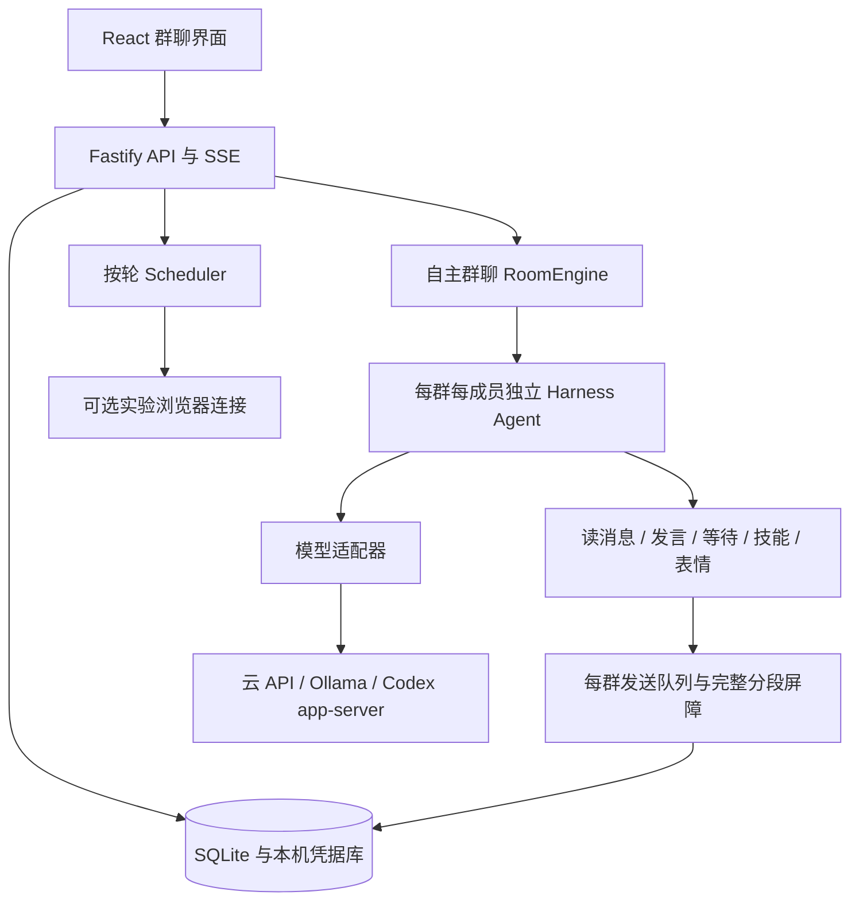

# 架构说明

茶馆是单进程本机应用：浏览器中的 React 界面通过同源 HTTP API 和 SSE 与 Fastify 交互；SQLite 保存状态；模型适配器连接固定官方端点或本机 Ollama。

## 模块

| 目录 / 文件 | 职责 |
| --- | --- |
| `src/` | 群聊、成员库、模型连接、日志、费用、订阅与浏览器界面 |
| `shared/` | 类型、默认设置、模型目录、价格参考和点名处理 |
| `server/app.ts` | 路由、静态资源、SSE、应用生命周期 |
| `server/room-engine/` | 事件唤醒、并发、游标、预算与有序公开发布 |
| `server/runtime-adapters/` | Harness 组合、受限工具、模型协议与错误处理 |
| `server/scheduler.ts` | 按轮讨论、顺序、上下文快照、总结与取消 |
| `server/subscription/` | 独立 Codex app-server 与官方授权/额度适配 |
| `server/browser-connector.ts` | 固定站点、独立浏览器配置、受控操作与完成识别 |
| `server/store.ts` / `server/vault.ts` | SQLite 与本机凭据加密 |
| `server/security.ts` / `server/validation.ts` | 来源检查、CSRF、校验和输入边界 |
| `tests/` | 不依赖真实账户的模拟回归与浏览器验收 |

## 独立成员与共享消息

长期成员档案保存身份；加入群后创建独立群内席位。每个席位有独立会话 ID、已读位置、关注方式和冷却计时。共用模型或密钥不会共用 Harness 私有会话，也不会把其他成员的人设当作自己的提示词。

公开消息进入群事件序列。符合新消息、点名或预约条件时，调度器按并发和预算准入；普通等待不轮询。模型工具只能读取当前群、引用已交付消息、发布本人内容、等待或读取已分配的文字技能。

## 思考与公开发送

思考可以并行，公开发布串行。模型提交完整正文后，由分段器保留内容并拆成气泡；完整组结束前不会交付半组给其他模型。人类始终可以插话。

新增 AI 观点不会使已准备的回复不断失效。发布只确认实际读过的事件，未读观点留到下次唤醒；如果已读到某组的一部分，仍需继续读完整。人类补充、引用权限、成员变更、取消与截止时间在发布前重新检查。

工具提交与实际发布分开记录状态。失败后切回思考并记录原因；未调用有效群聊动作的普通正文只作为私有草稿，最多一次提示模型提交发言或明确等待，不自动公开推理。

## 预算与取消

每次调用开始前原子预留输入、输出和金额，完成后按返回用量结算。并发预留不足与供应商余额不足分开处理。明确限流可以有限退避；额度耗尽、非法工具等无法安全重试的错误停止对应成员。

暂停通过 AbortSignal 和会话 epoch 使在途操作失效，阻止迟到回复。已发出的段落保留，未发出的段落不在重启后补发。重启恢复状态和预算，但不自动调用模型。

## 信任边界

后端持有凭据，前端只收到配置状态。群消息、目标和技能均不可信，不能授予额外工具权限。即使提示词被诱导，文件、Shell、任意 HTTP 或跨群发言也没有对应可调用工具。

公开消息发送给该群参与模型，私有会话和日志留在本机。云请求适用供应商的数据政策。本项目的边界详见 [SECURITY.md](../SECURITY.md)。
